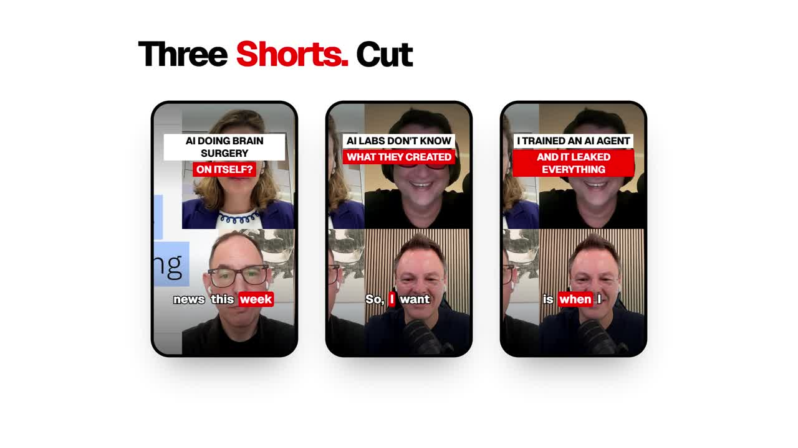

<div align="center">

# clipy

**Be #1 in your niche.**

Paste a YouTube video. clipy works out what's going viral in your niche right now,<br>
then cuts the three Shorts from your video most likely to take off, with hooks and captions already on.

[](docs/demo.mp4)

▶ [Watch the 22-second demo](docs/demo.mp4)

Built at a hackathon · Nov 2026

</div>

---

## Why

Every long video already has Shorts in it. The hard part is knowing *which* moments will work. That changes week to week and niche to niche.

Most clipping tools pick moments based only on your video. clipy starts with the market. It looks at what is getting views in your niche right now and learns the hook patterns, pacing, and caption style. Then it scans your full transcript for the moments that fit those patterns.

## Use cases

- **Podcasters and YouTubers:** turn a 2-hour episode into three ready-to-post Shorts
- **Clippers and agencies:** cut clips that match what's trending for each client's niche
- **Growth teams:** see which hooks are working with an audience before you script the next video

## How it works

```
YouTube URL
  → 1 ingest      yt-dlp                 timed transcript + mp4 (faster-whisper fallback)
  → 2 understand  LLM                    niche, keyword sets, comparable shows, topic map
  → 3 trends      Oriane ×3              30+ viral Shorts in the niche (accounts · topics · guests)
  → 4 playbook    LLM                    hook patterns, pacing, caption formula
  → 5 direct      LLM                    top 3 moments + rewritten hooks, scored against the playbook
  → 6 render      ffmpeg / libass        9:16 crop, burned-in hook, word-by-word captions
  → UI            Next.js                each section appears as its stage finishes
```

- **Market first, then the clips.** The playbook comes from real Shorts that are performing now, found by searching three ways: niche accounts, topic phrases, and guest names. Clip selection only happens after that.
- **Typed contracts.** Each stage reads and writes a Pydantic model defined in `contracts.py`, so every stage can run and be tested on its own using fixtures.
- **Two render engines.** `classic` uses Pillow overlays. `adaptive` uses libass for word-by-word captions. You can pick the engine per clip, for example `RENDER_ENGINE=adaptive,adaptive,classic`.
- **Cached and safe to run twice.** Downloads are cached per video and protected by a per-video lock, so repeat runs are instant.

## Stack

| Layer | Tech |
| --- | --- |
| Ingest | yt-dlp, faster-whisper (optional) |
| Reasoning | [GMI Cloud](https://gmicloud.ai) (OpenAI-compatible), Gemini Flash Lite |
| Viral trend data | [Oriane](https://oriane.xyz) content search |
| Rendering | ffmpeg, libass, Pillow |
| Backend | Python, FastAPI, Pydantic, uv |
| Frontend | Next.js, TypeScript |

## Run it

**Requirements:** Python with [uv](https://docs.astral.sh/uv/), Node 20+, and `ffmpeg` (`brew install ffmpeg`).

```bash
make setup                      # uv sync + backend/.env from .env.example
make dev                        # API on :8000 (USE_FIXTURES=all by default: no keys needed)
cd frontend && npm i && npm run dev
```

To run on a real video, add `GMI_API_KEY` and `ORIANE_API_KEY` to `backend/.env` and set `USE_FIXTURES=` to empty.

```bash
curl -X POST localhost:8000/jobs -H 'content-type: application/json' -d '{"url":"https://youtube.com/watch?v=..."}'
curl localhost:8000/jobs/<id>   # status: queued → ingest → understand → trends → playbook → direct → render → done
```

**Useful commands**

```bash
make stage N=3 SAVE=1           # run one stage on the fixture that feeds it, save its output
make renderer E=adaptive        # switch the render engine (classic | adaptive | per-clip list)
```

The adaptive engine needs ffmpeg built with libass. See [`backend/RENDER.md`](backend/RENDER.md).

## API

| Route | Purpose |
| --- | --- |
| `POST /jobs` `{url}` | Start a job. Returns a `Job` |
| `GET /jobs/{id}` | Poll the job. Each stage fills in its own field as it finishes |
| `GET /renders/*` | The rendered 9:16 mp4s |
| `GET /health` | Health check |

## Repo layout

```
backend/app/
  contracts.py       shared Pydantic shapes between every stage
  jobs.py, main.py   in-memory job runner + FastAPI routes
  pipeline/          s1_ingest … s6_render (+ s6_render_adaptive)
  prompts/           understand.md, playbook.md, direct.md
backend/fixtures/    one saved output per stage, for offline dev
frontend/            Next.js app: landing, clipper, timeline, phone previews
docs/                demo video
```

## Team

Jorge Meza · Faizan Hussain · and team
